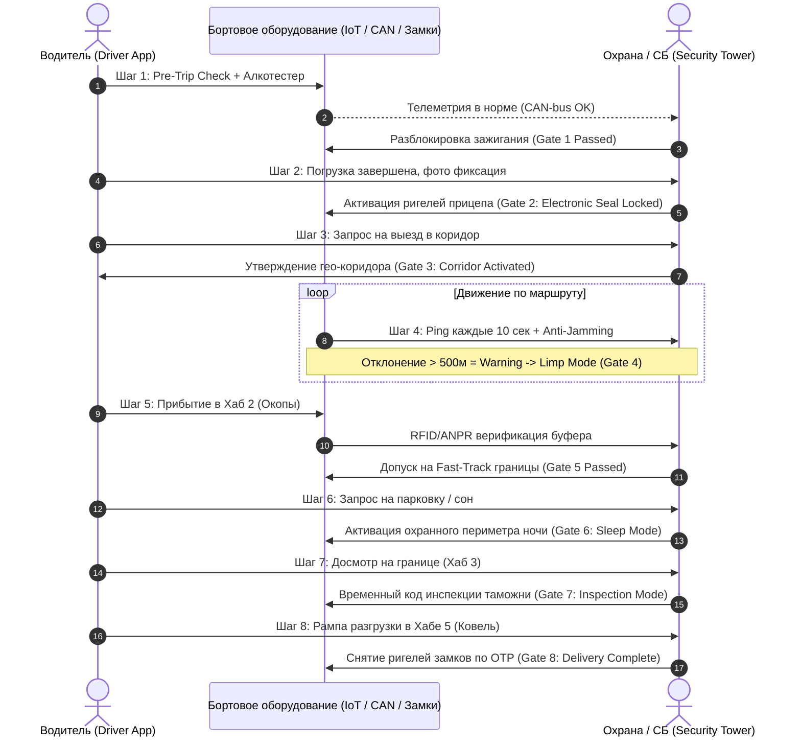
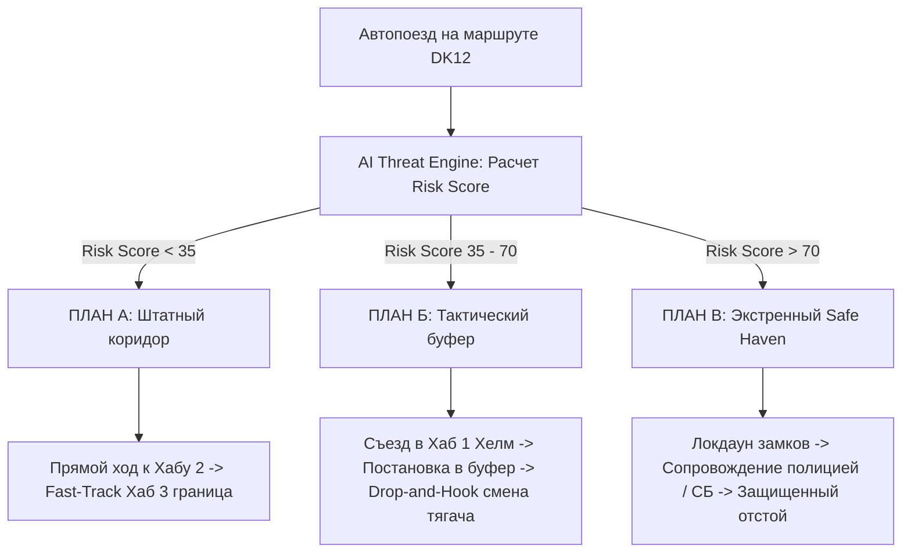

# MPL INTERNATIONAL — Спецификация Системы и Регламенты (APP_SPEC.md)
**Проект:** Цифровая платформа логистики, контур безопасности и защищенный буферный коридор  
**Версия:** 1.0.0 (Enterprise Spec)  
**Статус:** Утверждено к разработке для Antigravity  
**Контекст проекта:** Инвестиционная программа 12 000 000 PLN (PARP / ЕС), парк 20 тягачей Euro 6, трансграничные коридоры  

---

## Оглавление
1. [Пилотный проект: Secure Buffer Corridor «Dorohusk — Jagodzin» (5 Хабов)](#1-пилотный-проект-secure-buffer-corridor-dorohusk--jagodzin-5-хабов)
2. [Регламент: 8 шагов связки «Водитель ↔ Охрана (СБ)» с аппаратными блокировками](#2-регламент-8-шагов-связки-водитель--охрана-сб-с-аппаратными-блокировками)
3. [Матрица Problem Management (P1 / P2 / P3)](#3-матрица-problem-management-p1--p2--p3)
4. [Карта взаимопомощи (Mutual Aid P2P Map) и режим «Конвой»](#4-карта-взаимопомощи-mutual-aid-p2p-map-и-режим-конвой)
5. [AI Threat Engine: Risk Score и Планы А / Б / В](#5-ai-threat-engine-risk-score-и-планы-а--б--в)
6. [Технические контракты API и структуры данных для Antigravity](#6-технические-контракты-api-и-структуры-данных-для-antigravity)

---

## 1. Пилотный проект: Secure Buffer Corridor «Dorohusk — Jagodzin» (5 Хабов)

### 1.1. Проблема и бизнес-цель
Пограничный переход **Дорогуск (Польша) — Ягодин (Украина)** — один из ключевых грузовых шлюзов на восточной границе ЕС. Традиционные задержки (очереди 24–72 часа, забастовки фермеров, проверки контролирующих органов) приводят к простоям автопоездов Euro 6 стоимостью более €500/сутки на единицу.

**Бизнес-цель пилота:** Обеспечить безостановочное движение грузов (**«Грузы не стоят»**) за счет создания сквозного защищенного буферного коридора с виртуальной диспетчеризацией, челночной эстафетой (Drop-and-Hook) и цифровым предварительным таможенным клирингом.

```
[ Хаб 1: Хелм ] ──(25 км)──► [ Хаб 2: Окопы ] ──(12 км)──► [ Хаб 3: Граница ] ──(8 км)──► [ Хаб 4: Ягодин ] ──(45 км)──► [ Хаб 5: Ковель ]
  СВХ / Pre-Clearance          Virtual Gate / Staging         Fast-Track Transit           Смена тягача / СБ           Разгрузка / Магистраль
```

### 1.2. Архитектура и функционал 5 хабов коридора

| Хаб | Локация и назначение | Физическая инфраструктура | Цифровая автоматизация платформы MPL |
| :--- | :--- | :--- | :--- |
| **Хаб 1 (PL)** | **Хелм (Chełm Inland Terminal)**<br>*Входной таможенно-логистический хаб (PL)* | Охраняемая стоянка TAPA TSR Level 1, рампа досмотра, аккредитованные брокеры, весовой контроль. | • Электронный пре-клиринг e-CMR, T1, SENT.<br>• Автоматическая валидация пломб и сканирование документов в приложении.<br>• Регистрация в электронной очереди e-Queue. |
| **Хаб 2 (PL)** | **Окопы / Дорогуск Pre-Gate**<br>*Буферная зона ожидания за 12 км до границы* | Закрытый накопитель с автоматическими шлагбаумами, защищенный периметр, зона отдыха водителей. | • Virtual Gate Call: машина вызывается на границу только при готовности окна досмотра.<br>• Исключение живой очереди на трассе DK12.<br>• Проверка статуса электронных замков СБ. |
| **Хаб 3 (Border)** | **Пункт пропуска Дорогуск — Ягодин**<br>*Физическая линия границы PL — UA* | Выделенная полоса ускоренного проезда для защищенных цифровых автопоездов (Fast-Track Lane). | • Автоматическое считывание ANPR (распознавание номеров тягача и полуприцепа).<br>• «Режим инспекции» в приложении водителя (единый QR для таможни).<br>• Безбумажный проезд за 25–40 минут. |
| **Хаб 4 (UA)** | **Ягодин Buffer Staging Hub**<br>*Приграничный распределительный терминал (UA)* | Охраняемый хаб перецепки (Drop-and-Hook), сервисный пост, база отдыха экипажей. | • Смена тягача или водителя без простоя полуприцепа.<br>• Возврат тягача Euro 6 в сторону ЕС без нарушения норм Пакета Мобильности.<br>• Контрольная телеметрия целостности груза. |
| **Хаб 5 (UA)** | **Ковель / Любомль Logistics Hub**<br>*Финальный распределительный кластер* | Кросс-докинг класс А, подключение к железнодорожным веткам, локальная дистрибуция. | • Окончательное снятие ригелей СБ по защищенному OTP-коду.<br>• Автоматическая генерация закрывающих актов и биллинг.<br>• Подготовка порожнего рейса / обратной загрузки в ЕС. |

---

## 2. Регламент: 8 шагов связки «Водитель ↔ Охрана (СБ)» с аппаратными блокировками

Каждый шаг содержит **Hard Gate (аппаратную или системную блокировку)**. Переход к следующему шагу невозможен без взаимного подтверждения мобильного приложения водителя и пульта Службы Безопасности (Security Control Tower).



### Детальная спецификация 8 шагов и блокировок

```
+---------------------------------------------------------------------------------------------------+
| ШАГ 1: ИНИЦИАЛИЗАЦИЯ И PRE-TRIP CHECK                                                             |
| Действие водителя:    Авторизация по биометрии + Driver Card. Продувка через подключенный         |
|                       Bluetooth-алкотестер. Фотофиксация 6 точек машины (шины, сцепка, стекла).   |
| Блокировка (Gate 1):  Стартер ДВС физически разорван реле иммобилайзера. Блок управления двигателем |
|                       НЕ подает топливо до получения криптографического токена от СБ.             |
| Действие СБ:          Валидация путевого листа, сверка трезвости и допуска водителя -> Отправка   |
|                       команды `UNLOCK_STARTER`.                                                   |
+---------------------------------------------------------------------------------------------------+
                                                  │
                                                  ▼
+---------------------------------------------------------------------------------------------------+
| ШАГ 2: ПОГРУЗКА И ЭЛЕКТРОННОЕ ОПЛОМБИРОВАНИЕ                                                      |
| Действие водителя:    Контроль размещения паллет (Code-XL). Ввод номеров физических пломб в      |
|                       приложение + фото фиксация закрытых ворот.                                  |
| Блокировка (Gate 2):  Электромеханический ригельный замок задних дверей полуприцепа переводится в |
|                       режим `HARD_LOCKED`. Механическое открытие без повреждения кузова невозможно.|
| Действие СБ:          Проверка массы по датчикам давления пневмоподвески (защита от перегруза).   |
|                       Фиксация статуса: `CARGO_SEALED_OK`.                                        |
+---------------------------------------------------------------------------------------------------+
                                                  │
                                                  ▼
+---------------------------------------------------------------------------------------------------+
| ШАГ 3: ВЫЕЗД И ЗАХВАТ ГЕО-КОРИДОРА                                                                |
| Действие водителя:    Нажатие кнопки «Начать рейс» в приложении. Переход в режим грузовой         |
|                       навигации (выделенный коридор DK12).                                        |
| Блокировка (Gate 3):  Разрешен выезд исключительно по вектору согласованного трека. При попытке   |
|                       движения в противоположную сторону срабатывает зуммер в кабине.             |
| Действие СБ:          Активация коридорного мониторинга: коридор шириной ±500 метров от оси трассы.|
+---------------------------------------------------------------------------------------------------+
                                                  │
                                                  ▼
+---------------------------------------------------------------------------------------------------+
| ШАГ 4: ТРАНЗИТ ПО КОРИДОРУ И АНТИ-ДЖАММИНГ МОНИТОРИНГ                                             |
| Действие водителя:    Ведение автопоезда. Соблюдение скоростного лимита (до 85 км/ч) и интервала. |
| Блокировка (Gate 4):  Anti-Jamming Interlock: при фиксации подавления частот GPS/GSM бортовой     |
|                       компьютер переходит в автономный локдаун, отправляет сигнал SOS по          |
|                       резервному радиоканалу 868 МГц и через 30 сек ограничивает тягу до 20 км/ч.|
| Действие СБ:          Автоматический мониторинг пингов (каждые 10 сек). Отсутствие пинга >60 сек  |
|                       вызывает автоматический алерт P2, >120 сек — алерт P1.                      |
+---------------------------------------------------------------------------------------------------+
                                                  │
                                                  ▼
+---------------------------------------------------------------------------------------------------+
| ШАГ 5: ПРИБЫТИЕ В БУФЕРНЫЙ ХАБ 2 (ОКОПЫ)                                                          |
| Действие водителя:    Заезд в накопитель Хаба 2. Сканирование въездного QR-кода на шлагбауме.    |
| Блокировка (Gate 5):  Шлагбаум на выезд в сторону границы НЕ откроется, пока система не присвоит |
|                       статус `BORDER_GREEN_LIGHT` (готовность окна оформления на пункте пропуска).|
| Действие СБ:          Контроль нахождения тягача в безопасном периметре. Синхронизация с польской |
|                       таможней и электронной очередью.                                            |
+---------------------------------------------------------------------------------------------------+
                                                  │
                                                  ▼
+---------------------------------------------------------------------------------------------------+
| ШАГ 6: ОТСТОЙ И НОЧНОЙ ОТДЫХ НА ПАРКОВКЕ                                                          |
| Действие водителя:    Постановка автопоезда на стояночный тормоз в разрешенной зоне Хаба 2.       |
|                       Перевод приложения в режим «Отстой / Сон».                                  |
| Блокировка (Gate 6):  Запрет ночного отстоя вне сертифицированных геозон TAPA TSR. Включение      |
|                       объемных инфракрасных датчиков периметра прицепа и датчиков разреза тента.  |
| Действие СБ:          Включение режима «Тихий сторож»: любой удар по кузову или сдвиг ворот >2 мм |
|                       вызывает мгновенную тревогу на мониторе охраны без звука на стоянке.        |
+---------------------------------------------------------------------------------------------------+
                                                  │
                                                  ▼
+---------------------------------------------------------------------------------------------------+
| ШАГ 7: ПРОХОЖДЕНИЕ ГРАНИЦЫ (ХАБ 3: ДОРОГУСК — ЯГОДИН)                                             |
| Действие водителя:    Движение по полосе Fast-Track. Предъявление экрана «Режим Инспекции» с      |
|                       динамическим одноразовым QR-кодом таможенному офицеру.                      |
| Блокировка (Gate 7):  Если инспектор требует физического вскрытия для досмотра, ригель замка      |
|                       открывается ИСКЛЮЧИТЕЛЬНО по одноразовому SMS/OTP токену от дежурного СБ.   |
| Действие СБ:          Видеоконтроль досмотра через камеру заднего вида. Логирование причины       |
|                       открытия, ФИО инспектора и времени открытия. Повторный локдаун после.       |
+---------------------------------------------------------------------------------------------------+
                                                  │
                                                  ▼
+---------------------------------------------------------------------------------------------------+
| ШАГ 8: ФИНАЛИЗАЦИЯ И РАЗГРУЗКА (ХАБ 4 / ХАБ 5)                                                    |
| Действие водителя:    Постановка под рампу в Хабе 5 (Ковель). Нажатие «Готов к разгрузке».        |
| Блокировка (Gate 8):  Ригели открываются ТОЛЬКО если геокоординаты совпадают с полигоном склада   |
|                       (погрешность < 15 метров) И подтверждена электронная накладная e-CMR.       |
| Действие СБ:          Финальная деактивация охранного рейса. Снятие электронного опечатывания.    |
|                       Перевод автопоезда в статус `AVAILABLE_FOR_DISPATCH`.                       |
+---------------------------------------------------------------------------------------------------+
```

---

## 3. Матрица Problem Management (P1 / P2 / P3)

Система разделяет инциденты на 3 уровня с жесткими SLA и автоматизированными цепочками реагирования:

```
[ P1: КРИТИЧЕСКИЙ ]  ──► SLA: 60 сек  ──► Угон, нападение, SOS, срыв пломбы  ──► Локдаун, полиция 112, СБ
[ P2: ВЫСОКИЙ     ]  ──► SLA: 5 мин   ──► Поломка, пробка > 2ч, отклонение   ──► План Б, техпомощь, перерасчет
[ P3: СРЕДНИЙ     ]  ──► SLA: 15 мин  ──► Мелкая задержка, датчик, тахограф   ──► Логирование, пуш водителю
```

### Детальная матрица эскалации

| Уровень | Триггеры и события | SLA первого ответа | Автоматические действия системы | Действия оператора СБ / Диспетчера | Каналы коммуникации |
| :--- | :--- | :--- | :--- | :--- | :--- |
| **P1**<br>*(Критический)* | • Нажатие физической кнопки SOS или брелока.<br>• Срыв электронной/физической пломбы вне геозоны склада.<br>• Детекция работы глушилок (Jamming > 15 сек).<br>• Несанкционированное смещение автопоезда при заглушенном ДВС (эвакуация/буксировка).<br>• Опрокидывание (акселерометр > 45°). | **≤ 60 секунд** | 1. Блокировка замков дверей полуприцепа.<br>2. Плавное ограничение мощности ДВС при скорости < 15 км/ч.<br>3. Включение скрытого аудиомониторинга кабины.<br>4. Принудительное включение тревожного стрима GPS каждые 2 сек.<br>5. Отправка гео-пакета в дежурную часть полиции (112). | 1. Мгновенный проверочный звонок водителю по закрытому каналу.<br>2. Проверка кодового слова при ответе (Duress Code).<br>3. Направление группы быстрого реагирования / ближайшего экипажа конвоя.<br>4. Оповещение страхового комиссара (CMR/OCP). | • Push P1 (сирена на пульт СБ)<br>• Автодозвон через SIP-шлюз<br>• Выделенный зашифрованный чат тревоги<br>• Прямой шлюз полиции |
| **P2**<br>*(Высокий)* | • Очередь перед хабом / границей > 2 часов.<br>• Отклонение от коридора DK12 на 1–5 км без согласования.<br>• Техническая неисправность тягача Euro 6 (Check Engine, падение давления в шине TPMS).<br>• Сбой температурного режима (для рефрижератора ±2°C).<br>• Превышение лимита непрерывного вождения по тахографу (осталось < 15 мин). | **≤ 5 минут** | 1. Запуск сценария «План Б» (перенаправление в резервный буферный хаб).<br>2. Поиск ближайшего тягача взаимопомощи в радиусе 20 км.<br>3. Пересчет ETA и автоматическое смещение слота в e-Queue.<br>4. Push-уведомление клиенту о задержке. | 1. Связь с водителем через чат приложения.<br>2. Согласование объезда затора или санкционирование съезда на шиномонтаж.<br>3. Вызов мобильной техпомощи 24/7 (при поломке). | • Внутренний чат приложения<br>• SMS-резерв<br>• Диспетчерский тикет с авто-таймером эскалации |
| **P3**<br>*(Средний)* | • Задержка погрузки/разгрузки на 15–45 минут.<br>• Незначительный сбой передачи телеметрии (одиночный пропуск пинга).<br>• Запрос водителем смены парковки внутри хаба.<br>• Плановое напоминание о калибровке тахографа. | **≤ 15 минут** | 1. Автоматическая запись инцидента в аудит-лог рейса.<br>2. Мягкое уведомление водителю на экран планшета.<br>3. Корректировка графика без изменения основного SLA доставки. | 1. Ознакомление диспетчера без обязательного звонка.<br>2. Подтверждение смены парковочного места в один клик. | • Обычный push-нотификатор<br>• Запись в карточке рейса (Audit Trail) |

---

## 4. Карта взаимопомощи (Mutual Aid P2P Map) и режим «Конвой»

### 4.1. Разделение прав видимости (Zero-Trust Privacy & Security Architecture)
В целях предотвращения наводки криминальных групп и коммерческого шпионажа водители **НЕ имеют доступа к общей карте парка**.

```
[ Пульт СБ (Security Tower) ] ──► Полная видимость ВСЕХ 20+ тягачей, грузов, маршрутов и статусов (God Mode)
              ▲
              │
[ Водитель MPL (Driver App)  ] ──► Видит ТОЛЬКО тягачи MPL в радиусе 20 км (без стоимости груза) + Свой конвой
```

*   **Роль «Охрана / СБ (Security Tower) — God Mode»:**
    *   Видит на интерактивной карте все 20 единиц флота в реальном времени.
    *   Отображение параметров: текущая скорость, остаток топлива, состояние электронных замков, статус тахографа (Driver Card), Risk Score на маршруте, история тревог.
    *   Тепловая карта криминогенных зон и пограничных заторов.
*   **Роль «Водитель (Driver View) — Restricted Proximity Mode»:**
    *   Водитель видит на карте исключительно дружественные тягачи MPL в **радиусе 20 км**.
    *   Отображаемые данные коллеги: позывной машины (например, *«MPL-Unit-08»*), имя водителя, прямой PTT-канал рации / звонок, статус готовности оказать помощь.
    *   **Строго скрыто:** характер перевозимого груза, стоимость партии, заказчик, конечная точка назначения коллеги.

### 4.2. Механика взаимной технической помощи (P2P Assistance)
При проколе колеса, отказе стартера или нехватке антифриза/масла:
1. Водитель нажимает кнопку **«Запрос взаимопомощи»** и выбирает категорию: *(1) Колесо/Шина, (2) Воздух/Пневматика, (3) Пуск ДВС (провода 24V), (4) Буксировка, (5) Инструмент*.
2. Система отправляет push-запрос всем экипажам MPL в радиусе 20 км.
3. Коллега, подтвердивший готовность помочь, получает безопасный маршрут подъезда, а время его отвлечения автоматически компенсируется и согласовывается с диспетчером.

### 4.3. Режим «Конвой» (Secure Convoy Mode)
Для прохождения рискованных участков (ночной подъезд к границе, забастовочные зоны) машины объединяются в цифровой конвой из 2–4 автопоездов.

```
┌─────────────────┐       (дистанция 100-250 м)       ┌─────────────────┐
│  ВЕДУЩИЙ ТЯГАЧ  │ ◄───────────────────────────────► │  ВЕДОМЫЙ ТЯГАЧ  │
│  (Convoy Lead)  │       Защищенный Mesh-канал       │ (Convoy Follow) │
└─────────────────┘                                   └─────────────────┘
         │                                                     │
         └─────────────────────────┬───────────────────────────┘
                                   ▼
          Общая цепь тревоги: Нажатие SOS в одной машине
          вызывает тревогу во всех автопоездах связки и в СБ!
```

*   **Master-Slave телеметрия:** Ведущий тягач передает ведомому дорожные условия, препятствия и команды торможения.
*   **Сквозная тревожная цепь:** Срабатывание кнопки SOS или датчика удара на любой машине конвоя мгновенно включает режим повышенной готовности на всех остальных машинах группы и передает групповой сигнал тревоги в СБ.

---

## 5. AI Threat Engine: Risk Score и Планы А / Б / В

### 5.1. Формула и метрики Risk Score (0–100)
Модуль **AI Threat Engine** каждые 5 минут пересчитывает динамический индекс риска $R_{score}$ для текущего автопоезда:

$$R_{score} = w_1 \cdot Q_{border} + w_2 \cdot C_{crime} + w_3 \cdot S_{strike} + w_4 \cdot W_{weather} + w_5 \cdot D_{fatigue}$$

Где весовые коэффициенты распределены следующим образом:

1.  **$Q_{border}$ (Очередь на пункте пропуска Дорогуск, вес 35%):** Телеметрия очередей e-Queue, время ожидания (0 ч = 0, 12 ч = 50, >24 ч = 100).
2.  **$S_{strike}$ (Забастовки и блокады трассы DK12, вес 25%):** Мониторинг новостных лент, чатов фермеров, дорожных сводок полиции Польши.
3.  **$C_{crime}$ (Криминогенность локации по TAPA TSR, вес 15%):** Наличие инцидентов с кражами топлива и грузов в данном квадрате за последние 90 дней.
4.  **$W_{weather}$ (Погодные аномалии, вес 15%):** Обледенение трассы, штормовой боковой ветер > 20 м/с, сильный снегопад.
5.  **$D_{fatigue}$ (Усталость экипажа по тахографу / DMS-камере, вес 10%):** Время за рулем без отдыха, фиксация микросна камерой контроля внимания.

```
     Risk Score:
     0  ─────────────── 35 ──────────────────────── 70 ──────────────── 100
     [     ПЛАН А     ]    [        ПЛАН Б        ]    [     ПЛАН В     ]
     Штатный транзит       Тактический буфер           Критический локдаун
```

### 5.2. Сценарии действий: Планы А, Б, В



#### План А: «Штатный сквозной транзит» (Risk Score < 35)
*   **Условия:** Очередь на границе < 2 часов, трасса чистая, забастовок нет, погода в норме.
*   **Действие:** Прямое безостановочное движение через Хаб 1 и Хаб 2 на выделенную полосу Хаба 3 (Дорогуск — Ягодин).
*   **Скорость коридора:** Полный цикл прохождения от Хелма до Ягодина < 3.5 часов.

#### План Б: «Тактический буферный маневр» (Risk Score 35–70)
*   **Условия:** Задержка на границе 4–12 часов, частичное перекрытие подъездов фермерами, плохая погода.
*   **Действие:**
    1. Автопоезд принудительно направляется в **Хаб 1 (Хелм)** или закрытый накопитель **Хаба 2 (Окопы)**.
    2. Тягач сдает полуприцеп на охраняемой площадке (Drop-and-Hook).
    3. Водитель отправляется на отдых в мотель хаба, либо тягач переключается на выполнение регионального рейса внутри Польши.
    4. Полуприцеп ожидает открытия «зеленого окна» и забирается челночным тягачом по факту вызова виртуальной очереди.
*   **Результат:** Дорогостоящий тягач Euro 6 и водитель не стоят в многочасовой дорожной пробке.

#### План В: «Критический Safe Haven / Конвойный локдаун» (Risk Score > 70)
*   **Условия:** Полная блокада погранперехода забастовщиками, попытка криминального нападения, шторм, перекрытие трассы полицией.
*   **Действие:**
    1. Немедленная аппаратная блокировка всех замков полуприцепа.
    2. Принудительное перенаправление в ближайший защищенный опорный пункт СБ (Safe Haven) под вооруженную охрану.
    3. Запрет на покидание кабины водителем до прибытия экипажа СБ или дорожной полиции.
    4. Перевод рейса в режим ожидания с уведомлением руководства компании и клиентов.

---

## 6. Технические контракты API и структуры данных для Antigravity

Ниже приведены контракты и схемы данных для реализации бекенда и мобильного клиента.

### 6.1. Модель данных инцидента (TypeScript Interface)

```typescript
export type IncidentSeverity = 'P1_CRITICAL' | 'P2_HIGH' | 'P3_MEDIUM';

export type IncidentTriggerType = 
  | 'PANIC_BUTTON_HARDWARE'
  | 'PANIC_BUTTON_KEYFOB'
  | 'SEAL_INTEGRITY_BREACH'
  | 'JAMMING_DETECTED'
  | 'CORRIDOR_DEVIATION_500M'
  | 'BORDER_QUEUE_OVERDUE_2H'
  | 'TPMS_PRESSURE_DROP'
  | 'TACHO_HOURS_EXHAUSTED';

export interface SecurityIncident {
  incident_id: string;              // UUIDv4
  unit_id: string;                  // e.g. "MPL-TRUCK-04"
  driver_id: string;                // e.g. "DRV-PL-882"
  severity: IncidentSeverity;
  trigger: IncidentTriggerType;
  timestamp: string;                // ISO 8601 UTC
  location: {
    lat: number;
    lng: number;
    speed_kmh: number;
    heading_deg: number;
    corridor_segment: 'CHELM_OKOPY' | 'OKOPY_BORDER' | 'JAGODZIN_KOVEL';
  };
  interlocks_engaged: {
    engine_inhibited: boolean;
    trailer_deadbolt_locked: boolean;
    silent_audio_stream_active: boolean;
    police_notified_112: boolean;
  };
  duress_code_flag: boolean;
  assigned_operator_id?: string;
  resolution_status: 'OPEN' | 'INVESTIGATING' | 'ESCALATED' | 'RESOLVED';
  sla_deadline_utc: string;
}
```

### 6.2. Эндпоинт расчета P2P Взаимопомощи (POST `/api/v1/p2p/assistance-request`)

```json
// Request Payload:
{
  "requesting_unit_id": "MPL-TRUCK-12",
  "category": "TIRE_PUNCTURE_TPMS",
  "coords": {
    "lat": 51.1724,
    "lng": 23.6105
  },
  "description": "Повреждение правого внешнего колеса полуприцепа на DK12. Требуется помощь с запаской."
}

// Response Payload (фильтрует видимость до 20 км):
{
  "request_id": "P2P-REQ-20261007-0091",
  "status": "DISPATCHED",
  "nearby_peers_count": 2,
  "peers_within_20km": [
    {
      "unit_id": "MPL-TRUCK-03",
      "driver_callsign": "Marek_K",
      "distance_km": 8.4,
      "eta_minutes": 11,
      "tacho_can_assist": true,
      "has_matching_spare_tire": true
    },
    {
      "unit_id": "MPL-TRUCK-17",
      "driver_callsign": "Piotr_W",
      "distance_km": 16.2,
      "eta_minutes": 22,
      "tacho_can_assist": false,
      "has_matching_spare_tire": false
    }
  ]
}
```

### 6.3. Эндпоинт расчета AI Threat Engine (GET `/api/v1/threat-engine/unit-status/:unit_id`)

```json
// Response Payload:
{
  "unit_id": "MPL-TRUCK-07",
  "corridor": "DOROHUSK_JAGODZIN",
  "current_hub_milestone": "HUB_2_OKOPY_PREGATE",
  "risk_assessment": {
    "composite_risk_score": 58,
    "risk_level": "AMBER_ELEVATED",
    "active_plan": "PLAN_B_TACTICAL_BUFFER",
    "factors": {
      "border_queue_hours": 7.5,
      "border_queue_score": 65,
      "farmer_strike_probability_pct": 80,
      "tapa_theft_hotspot_index": 15,
      "weather_condition": "RAIN_WET_ROAD",
      "driver_tacho_remaining_drive_min": 140
    }
  },
  "tactical_instructions": {
    "action": "DIVERT_TO_HUB_1_OR_HUB_2_BUFFER",
    "designated_safe_bay": "OKOPY_BUFFER_BAY_14",
    "interlocks": {
      "drop_and_hook_trailer_allowed": true,
      "max_transit_speed_kmh": 70
    },
    "estimated_clearance_window_utc": "2026-10-07T21:30:00Z"
  }
}
```

---

## 7. Критерии приемки реализации (Definition of Done для Antigravity)

1. **Аппаратные шлюзы (Hard Gates):** Реализована эмуляция/интеграция всех 8 шагов регламента. Переход статуса рейса невозможен без прохождения валидации предыдущего шага.
2. **Безопасность замков:** Замки прицепа невозможно открыть удаленно, если геопозиция тягача выходит за пределы полигона согласованного хаба/склада.
3. **P2P Ограничение:** В мобильном приложении водителя радиус поиска строго ограничен 20 км. Проверено отсутствие утечки данных о грузе коллеги в HTTP-ответах.
4. **Конвойный режим:** Создание конвоя из 2+ машин объединяет их канал тревоги: симуляция нажатия SOS на ведомом тягаче зажигает тревогу P1 у ведущего и на пульте охраны за время < 1.5 секунды.
5. **Тестирование Планов А/Б/В:** При искусственном повышении времени ожидания границы до 8 часов система автоматически переключает активный маршрут с Плана А на План Б и перенаправляет автопоезд в буферную зону Хаба 2.
